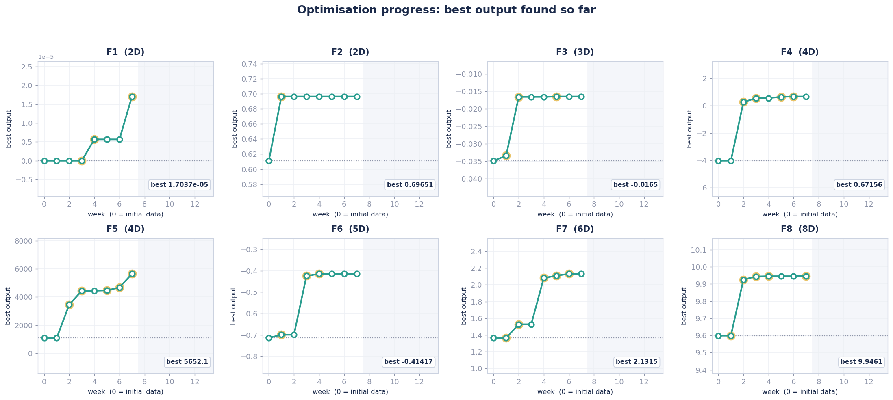

# Black Box Optimisation Capstone

**Student:** Avi Thakur | **Cohort:** IMP-PCMLAI-26-06
**Course:** Imperial College London Professional Certificate in Machine Learning and Artificial Intelligence

## The challenge

There are eight unknown functions, from 2 to 8 inputs each. Every input is a number between 0 and 1. I cannot see inside the functions. Each week I may send one input point per function and get back one output value. The goal is to find the input that gives the highest output for each function, with as few queries as possible.

| Function | Inputs | What it stands for |
|---|---|---|
| F1 | 2 | Finding a radiation source. The output is close to zero except near a source. |
| F2 | 2 | A noisy log likelihood with local optima. |
| F3 | 3 | Drug discovery. Side effects are negated, so closer to zero is better. |
| F4 | 4 | Warehouse placement with many local optima. |
| F5 | 4 | Chemical yield, usually with a single peak. |
| F6 | 5 | A cake recipe. The score is negative by design, so closer to zero is better. |
| F7 | 6 | Tuning six settings of a machine learning model. |
| F8 | 8 | Tuning eight settings of a machine learning model. |

## My method

For Weeks 1 to 7 I used one method for all eight functions: a Gaussian Process with a Matern kernel and Expected Improvement. From Week 8 I use a different method for each function, chosen by how well that method is shown to work on that function.

1. For each function I fit models on the starting data plus every weekly result so far.
2. I test ten kinds of model, not one: three Gaussian Process kernels (Matern, RBF and Rational Quadratic), Random Forest, Extra Trees, Gradient Boosting, Support Vector Regression, nearest neighbours, a neural network and polynomial regression with ridge regularisation.
3. I score each model the way the real task works. For each week I train only on the starting data and the earlier weeks, then predict that week's point. Leave one out testing is not safe here, because it lets a model see later weeks when it predicts an earlier one, and that makes every score look far better than it is.
4. For each function I then choose how to decide. Where a model passes that honest test, I use it. Where no model passes, I use a designed experiment that changes one input at a time, or space filling if there is nothing left to refine. Where the raw results show a clear trend, I follow the trend and ignore the models.
5. I check every candidate against the results I already have, and I reject any point that contradicts something I have measured directly.

The weekly notes record which method was used for each function and why.

## Best result so far (after Week 7)

| Function | Best output | Week found | From starting data |
|---|---|---|---|
| F1 | 1.70e-05 | 7 | 7.71e-16 |
| F2 | 0.6965 | 1 | 0.6112 |
| F3 | -0.0165 | 5 | -0.0348 |
| F4 | 0.6716 | 6 | -4.0255 |
| F5 | 5652.15 | 7 | 1088.86 |
| F6 | -0.4142 | 4 | -0.7143 |
| F7 | 2.1315 | 6 | 1.3650 |
| F8 | 9.94614 | 7 | 9.5985 |

F5 is now 5.2 times its starting value and F1 has risen by eleven orders of magnitude. F2, F3, F6 and F7 have settled and their remaining gains are small.



## Weekly notes

Each week has its own file with the inputs, the outputs, what I learned and the plan for the next round.

* [Week 1](Week_1_Progress.md)
* [Week 2](Week_2_Progress.md)
* [Week 3](Week_3_Progress.md)
* [Week 4](Week_4_Progress.md)
* [Week 5](Week_5_Progress.md)
* [Week 6](Week_6_Progress.md)
* [Week 7](Week_7_Progress.md)
* [Week 8](Week_8_Progress.md)

## Files in this repository

| File | What it holds |
|---|---|
| `submissions.json` | Every weekly input and output, and the reason for each choice |
| `visualise_progress.py` | Fits the models and draws every chart in `figures/` |
| `figures/` | Progress charts, model quality and input sensitivity |
| `initial_data/` | The starting data given by the course |

To redraw the charts, run:

```
pip install numpy scipy scikit-learn matplotlib
python visualise_progress.py
```
